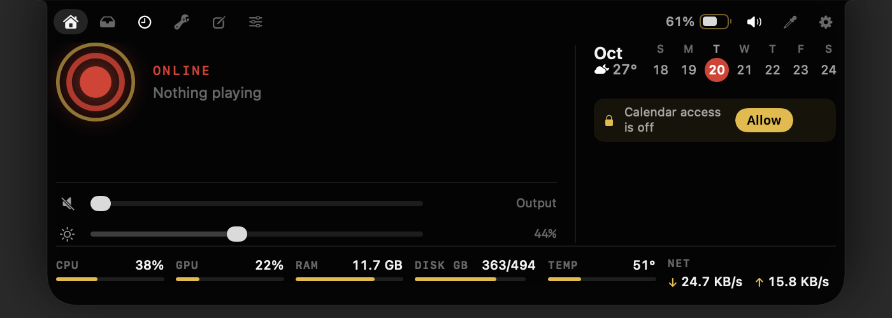
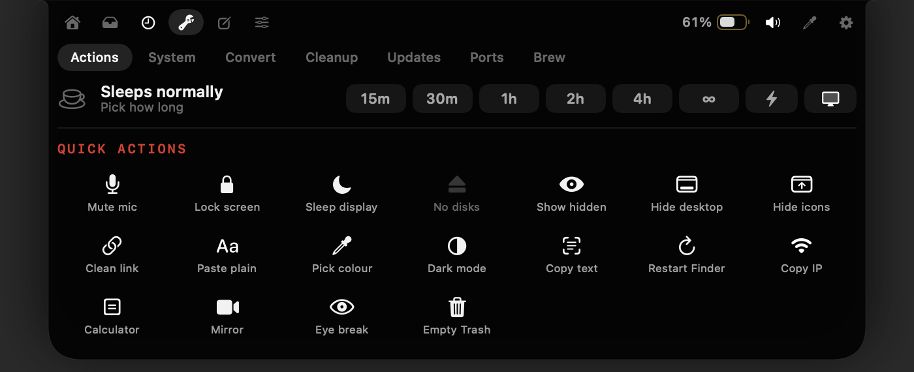
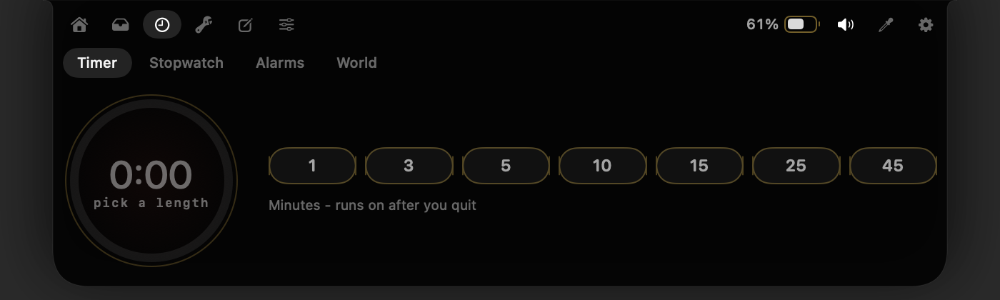

# DynamicNotch

A Dynamic Island for the MacBook notch. Point at the notch and it opens: what's
playing, your calendar and the weather, a file shelf, timers, quick tools and more.
It costs almost nothing while you work - nothing runs in the background on a timer.



## Install

You need an Apple Silicon Mac on macOS 26 or later. It is made for MacBooks with a
notch, and draws its own island on displays without one.

**With Homebrew** (one command):

```bash
brew install --cask agent15-ai/tap/dynamicnotch
```

**Or download** `DynamicNotch-x.y.z.zip` from
[Releases](https://github.com/Agent15-AI/DynamicNotch/releases/latest), unzip it, and
drag `DynamicIsland.app` into your Applications folder. It has to be in
Applications. Then run this once in Terminal:

```bash
xattr -dr com.apple.quarantine /Applications/DynamicIsland.app
```

That is needed because the app is not notarized (notarizing takes a paid Apple
Developer account), so macOS blocks a downloaded copy until you allow it. Instead
of the command you can open the app once, then go to System Settings → Privacy &
Security and click **Open Anyway**. Homebrew does this step for you.

It keeps itself up to date: when a new version is out, the island tells you, and a
click installs it.

## Getting started

- **Open the island** by moving the pointer to the notch. Move away and it closes.
  `⌃⌘N` opens and closes it from the keyboard, and `Esc` closes it.
- **Command bar:** press `⌥Space`. Open apps, find files, do sums and unit
  conversions, ask "what's on tomorrow" or "will it rain on friday", or run any of
  the island's actions by name.
- **Menu bar capsule:** a small capsule sits in your menu bar. Click it to hide your
  other menu bar icons, and click again to bring them back (`⌃⌘B`). Right-click it
  for **Settings**, **Check for Updates** and **Quit**.

On first launch the island briefly says how to open it, then stays out of the way.

## What it does



- **Now Playing** - artwork, play/pause, skip and a scrubber for Music, Spotify,
  browsers and anything else that tells macOS what it is playing. Swipe sideways on
  the closed notch to change track. Optional lyrics.
- **Calendar and weather** - this week at a glance, today's events, and a heads-up a
  few minutes before a meeting - click it to join the call.
- **Shelf** - drop files on the notch to park them for later. Clipboard history
  lives here too, and anything a password manager copies is never saved.
- **Clock** - timer, stopwatch, alarms and world clocks. A timer keeps going even
  if you quit the app.
- **Tools** - keep the Mac awake, mute the microphone, lock the screen, copy text
  from anywhere on screen, pick a colour, clean tracking junk from links, empty the
  Trash, a calculator, a camera mirror, eye-break reminders, system stats, file
  conversion, cache cleanup and an app uninstaller, Homebrew and App Store updates,
  and which apps are using which ports.
- **Notes** - a scratchpad that is always one hover away.
- **App volume** - a volume slider for each app that is playing sound.
- **Live activities** - the closed notch briefly shows charging, Bluetooth devices
  connecting (with their battery), finished downloads, new screenshots (drag one
  straight into an app), the microphone being in use, and a copied verification
  code (click to copy just the code).
- **Menu bar** - hide icons you don't need and reorder them, like Bartender or Ice.



## Permissions

Nothing is asked for when the app starts. Each feature asks the first time you use
it - the calendar when you press **Allow**, for example - and Settings → Modules
lists every permission with a button to grant it. Turn off any feature you don't
want in the same place.

macOS can forget a permission after an update. If a feature says it was "granted to
an older build", switch that permission off and on again in System Settings.

## Settings

Right-click the menu bar capsule → **Settings**. Choose which features are on, how
big the island is, what the closed notch shows, and whether the app starts at login
(on by default).

## Uninstall

`brew uninstall --cask dynamicnotch` if you used Homebrew. Otherwise right-click the
capsule → **Quit**, then drag `DynamicIsland.app` to the Trash. Its settings are in
`~/Library/Preferences/dev.local.dynamicisland.plist` and
`~/Library/Application Support/DynamicIsland`.

## Build from source

With Xcode 26 or later (tested with 27.1):

```bash
./make.sh && open /Applications/DynamicIsland.app
```

How everything works, module by module, is in [docs/DEVELOPMENT.md](docs/DEVELOPMENT.md).

## License

MIT - see [LICENSE](LICENSE). It includes code from DynamicNotchKit,
mediaremote-adapter, shine and Sparkle, each under its own licence: see
[THIRD_PARTY_NOTICES.md](THIRD_PARTY_NOTICES.md).
